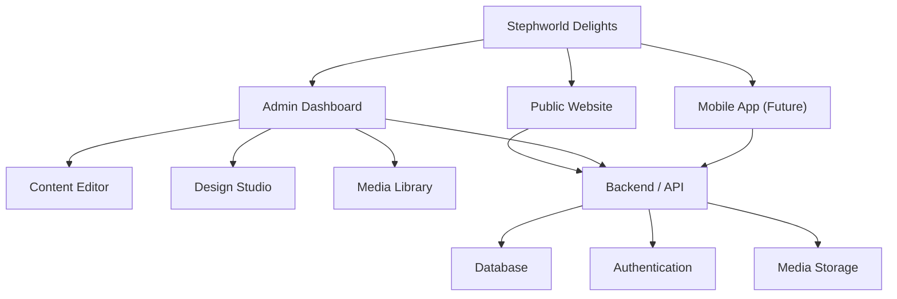

# Stephworld Delights — Architecture

## 1. System Architecture



## 2. Project Structure

```text
Stephworld-Delights/
│
├── application/
│   ├── web/
│   │   ├── public/
│   │   ├── src/
│   │   │   ├── app/
│   │   │   ├── components/
│   │   │   ├── config/
│   │   │   ├── data/
│   │   │   └── lib/
│   │   └── package.json
│   │
│   └── mobile/          # Future development
│
├── packages/
│   └── shared/          # Future shared code
│
├── docs/
│   ├── requirements.md
│   └── architecture.md
│
└── README.md
```
