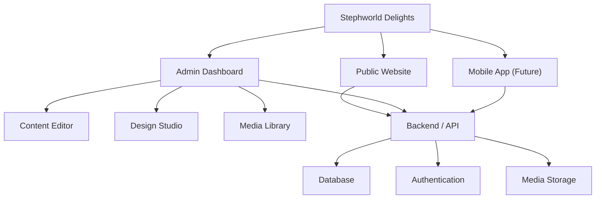

# Stephworld Delights — Architecture

## 1. System Architecture



## 2. Project Structure

```text
Stephworld-Delights/
│
├── application/
│   ├── web/
│   │   ├── public/
│   │   ├── src/
│   │   │   ├── app/
│   │   │   ├── components/
│   │   │   ├── config/
│   │   │   ├── data/
│   │   │   └── lib/
│   │   └── package.json
│   │
│   └── mobile/          # Future development
│
├── packages/
│   └── shared/          # Future shared code
│
├── docs/
│   ├── requirements.md
│   └── architecture.md
│
└── README.md
```
## 3. Define the component architecture for the navigation system
```text
application/web/
└── src/
    ├── app/
    │   ├── layout.tsx
    │   ├── globals.css
    │   ├── home/
    │   │   └── page.tsx
    │   ├── products/
    │   │   └── page.tsx
    │   ├── abouts/
    │   │   └── page.tsx
    │   ├── contact/
    │   │   └── page.tsx
    │   └── cart/
    │       └── page.tsx
    │
    ├── components/
    │   ├── layout/
    │   │   ├── AppShell.tsx
    │   │   └── ThemeProvider.tsx
    │   │
    │   └── navigation/
    │       ├── TopNavigation.tsx
    │       ├── LeftSidebar.tsx
    │       └── RightSidebar.tsx
    │
    └── config/
        └── theme-default.ts

public/
└── images/
    └── logo/
        └── logo.jpeg
```

### Component responsibilities

│Component │	Responsibility│
│---│---│
│layout.tsx	│ Global application layout and metadata │
│AppShell.tsx	│ Navigation state, responsive behavior, content resizing│
│ThemeProvider.tsx │	Mapping centralized design tokens to CSS variables│
│TopNavigation.tsx	│ Logo, brand name, menu, account and cart controls│
│LeftSidebar.tsx │	Main website navigation│
│RightSidebar.tsx │	Account navigation│
│theme-default.ts	│ Centralized colors, typography, spacing and effects│
│globals.css │	Global styles and theme-variable consumption│
│---│---│

### Architecture overview

flowchart TD
    A["Root Layout"] --> B["AppShell"]
    A --> C["Theme Variables"]
    B --> D["TopNavigation"]
    B --> E["Page Content"]
    D --> F["LeftSidebar"]
    D --> G["RightSidebar"]
    C -.-> D
    C -.-> F
    C -.-> G
    C -.-> E
    H["theme-default.ts"] --> C

## 4. Define the component architecture for the homepage structure
```text
application/web/src/
├── app/
│   └── home/
│       └── page.tsx
│
├── components/
│   ├── home/
│   │   ├── HeroSection.tsx
│   │   ├── CategorySection.tsx
│   │   ├── FeaturedProducts.tsx
│   │   ├── AboutPreview.tsx
│   │   └── ContactSection.tsx
│   │
│   └── layout/
│       ├── AppShell.tsx
│       └── Footer.tsx
│
└── config/
    └── theme-default.ts
```

## Recommended testing architecture

flowchart TD
    A["GitHub Repository"] --> B["Vercel Deployment"]
    B --> C["stephworld.ndeluma.com"]
    D["Cloudflare DNS"] --> C
    C --> E["Wife and Friends"]
    E --> F["Feedback and Bug Reports"]
    F --> G["Development Improvements"]
    G --> A